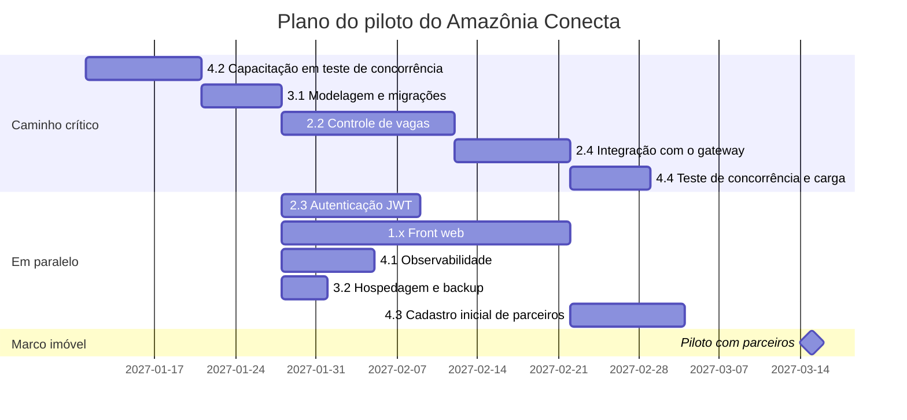

# Plano de Projeto: Amazônia Conecta

**Autor:** Alessandro de Oliveira Ramos
**Disciplina:** Projetos de Sistemas (CIESA)
**Etapa:** 2, do projeto ao plano de projeto
**Data:** 23/11/2026
**Base:** arquitetura da Etapa 1, no `README.md` deste repositório

## 0. Premissas gerais

Toda estimativa deste plano vale só dentro destas premissas. Os valores monetários são estimativas declaradas para fins do exercício, não cotações reais.

| ID | Premissa |
|----|----------|
| P1 | Equipe de uma pessoa (o autor), em dedicação parcial. A dedicação já está embutida nas estimativas em dias. |
| P2 | Dias são dias corridos de calendário, e cada dia de PERT equivale a 4 h de trabalho. Valor da hora do autor: R$ 60 (simulado). |
| P3 | O Amazônia Conecta é um projeto privado, então a Lei 14.133/2021 não obriga licitação. Prazos de contratação comerciais: gateway 15 dias, hospedagem 5 dias, mensageria 7 dias. A sensibilidade ao prazo de 90 dias da lei está na seção 2.6. |
| P4 | Marco imóvel: lançamento do piloto com os primeiros parceiros em **15/03/2027**, data combinada com eles. |
| P5 | Limites da frente: investimento de até R$ 6.000 (hospedagem, observabilidade e capacitação) e custeio de até R$ 6.000 por ano. |
| P6 | Início do trabalho em 11/01/2027. |
| P7 | Tarifa do gateway, domínio, e-mail e WhatsApp são iguais nas duas alternativas de custo e ficam fora da comparação. |

## 1. Rastreabilidade: decisão da Etapa 1 e pacotes

Regra do plano: pacote que não aparece nesta tabela não entra.

| Decisão (Etapa 1) | Pacotes que cria | Pacote que elimina |
|-------------------|------------------|--------------------|
| ADR-001 Aplicação web responsiva (React) | 1.1 a 1.4 (front web) | Dois apps nativos (Android e iOS) e a publicação nas lojas |
| ADR-002 PostgreSQL | 3.1 Modelagem e migrações, 2.2 Controle de vagas, 4.4 Teste de concorrência | Reconciliação manual de reservas acima da lotação |
| ADR-003 JWT de curta duração | 2.3 Autenticação com refresh token | Armazenamento de sessão compartilhado entre instâncias |
| Gateway de pagamento (nível 1 do C4) | 2.4 Cliente do gateway | Tratamento de dados de cartão (RNF04) |
| Aviso por e-mail e WhatsApp (RF12) | 2.5 Cliente de notificações | Confirmação manual ao turista |
| Operação da plataforma (RNF05 e RNF08) | 3.2 Hospedagem e backup, 4.1 Observabilidade | Sem eliminação |

Os pacotes de transição (4.1 a 4.4) não vêm da arquitetura em si. Vêm do trabalho de chegar até ela.

## 2. Entregáveis

### 2.1 Escopo: EAP

```mermaid
flowchart TD
    P["Amazônia Conecta: piloto em produção"]
    P --> F["1 Front web (ADR-001)"]
    P --> B["2 API e serviços"]
    P --> D["3 Dados e hospedagem (ADR-002)"]
    P --> T["4 Transição"]
    F --> F1["1.1 Busca de ofertas"]
    F --> F2["1.2 Fluxo de reserva e pagamento"]
    F --> F3["1.3 Painel do parceiro"]
    F --> F4["1.4 Painel do administrador"]
    B --> B1["2.1 Serviço de ofertas"]
    B --> B2["2.2 Controle de vagas"]
    B --> B3["2.3 Autenticação JWT (ADR-003)"]
    B --> B4["2.4 Cliente do gateway"]
    B --> B5["2.5 Cliente de notificações"]
    D --> D1["3.1 Modelagem e migrações"]
    D --> D2["3.2 Hospedagem e backup"]
    T --> T1["4.1 Observabilidade"]
    T --> T2["4.2 Capacitação em teste de concorrência"]
    T --> T3["4.3 Cadastro inicial de parceiros"]
    T --> T4["4.4 Teste de concorrência e carga"]
```



**Pacotes eliminados pelas decisões:** apps nativos e lojas (ADR-001), reconciliação manual de reservas (ADR-002), armazenamento de sessão compartilhado (ADR-003). Estes pacotes não têm custo nem prazo no plano.

**Modelo de pacote (exemplo preenchido):**

```
ID            : 2.2
Pacote        : Controle de vagas
Entrega       : operação de reserva com UPDATE condicional e CHECK (vagas >= 0)
Decisão-origem: ADR-002 (PostgreSQL)
Responsável   : desenvolvedor back-end
Estimativa    : O=8 M=15 P=30 -> PERT 16,3 dias
Depende de    : 3.1 Modelagem e migrações
Habilita      : 2.4 Cliente do gateway
```

### 2.2 Cronograma e caminho crítico

| Dependência | Por quê |
|-------------|---------|
| 4.2 Capacitação antes de 3.1 | Ninguém na equipe domina teste de concorrência hoje, e o modelo de vagas é desenhado já pensando em como será testado. |
| 3.1 Modelagem antes de 2.2 e 1.x | A transação de vagas e o contrato da API saem das tabelas. |
| 2.2 Controle de vagas antes de 2.4 Gateway | O pagamento só é cobrado sobre uma reserva que já segurou a vaga (reserva "aguardando pagamento" por 15 min). |
| 4.1 Observabilidade antes de 4.4 Teste | Teste sem telemetria não prova nada. |
| 2.3 Autenticação antes de 4.4 Teste | O fluxo ponta a ponta exige login dos três perfis. |
| Tudo antes do marco | A data do piloto é fixa. O escopo se negocia, a data não. |

**Caminho crítico:** 4.2 Capacitação, 3.1 Modelagem, 2.2 Controle de vagas, 2.4 Gateway, 4.4 Teste, marco.
**Em paralelo (depois de 3.1):** 2.3 Autenticação, 1.x Front, 4.1 Observabilidade. Como só há uma pessoa, o paralelismo é de ordem lógica, não de pessoas simultâneas. Isso é uma limitação declarada (P1).
**Marco imóvel:** piloto em 15/03/2027, com congelamento de mudanças nas 72 h anteriores.



Folga entre o fim do trabalho (04/03) e o marco (15/03): 11 dias, divididos na seção 2.5 em 8 dias de contingência e 3 de reserva gerencial.

### 2.3 Custo em três anos

Alternativas comparadas (mesma arquitetura, hospedagem diferente):

- **A: nuvem gerenciada** (hospedagem de aplicação, PostgreSQL gerenciado com backup automático).
- **B: servidor virtual próprio** (VPS com PostgreSQL e backup configurados à mão).

| Alternativa | Implantação | Operação por ano | Total em 3 anos |
|-------------|-------------|------------------|-----------------|
| A: nuvem gerenciada | R$ 2.880 | R$ 4.080 | R$ 15.120 |
| B: VPS própria | R$ 5.736 | R$ 7.080 | R$ 26.976 |

**Como cada número foi montado (simulado):**
- **A, implantação:** pacotes 3.2 (3,5 dias) e 4.1 (8,5 dias) = 12 dias x 4 h x R$ 60.
- **A, operação:** aplicação R$ 100 por mês + PostgreSQL gerenciado com backup R$ 120 por mês = R$ 2.640 por ano, mais 2 h por mês de manutenção (R$ 1.440).
- **B, implantação:** 3.2 sobe para 11,2 dias (instalar e proteger servidor, TLS, backup) e 4.1 para 12,7 dias (monitorar também o servidor) = 23,9 dias x 4 h x R$ 60.
- **B, operação:** VPS R$ 90 por mês + backup externo R$ 20 por mês = R$ 1.320 por ano, mais 8 h por mês de manutenção (R$ 5.760).
- **Total:** implantação + 3 x operação.
- **Capacitação (4.2):** 40 h x R$ 60 = R$ 2.400, igual nas duas alternativas, material gratuito.

**Limites (P5):**

| | Investimento (impl. + capacitação) | Limite | Custeio por ano | Limite |
|---|---|---|---|---|
| A | R$ 5.280 | R$ 6.000: cabe | R$ 4.080 | R$ 6.000: cabe |
| B | R$ 8.136 | R$ 6.000: estoura | R$ 7.080 | R$ 6.000: estoura |

**Conclusão:** a alternativa A custa R$ 11.856 a menos em 3 anos e é a única que respeita os limites. A operação responde por 81% do total da A (R$ 12.240 de R$ 15.120), o que confirma que comparar só a implantação esconderia o custo real.

**Reservas de custo:** contingência de 10% sobre a implantação da A (R$ 288) e reserva gerencial de 5% (R$ 144).

### 2.4 Estimativa dos pacotes (PERT)

PERT = (O + 4M + P) / 6 e desvio = (P − O) / 6. Estimativas simuladas.

| Pacote | O | M | P | PERT (dias) | Desvio | A cauda pessimista vem de |
|--------|---|---|---|-------------|--------|---------------------------|
| 4.2 Capacitação | 5 | 10 | 20 | 10,8 | 2,5 | Curva de aprendizado da ferramenta (R4) |
| 3.1 Modelagem e migrações | 4 | 7 | 14 | 7,7 | 1,7 | Ajustes de esquema após revisar RF e RN |
| 2.2 Controle de vagas | 8 | 15 | 30 | 16,3 | 3,7 | Concorrência (R1) |
| 2.4 Gateway | 6 | 10 | 25 | 11,8 | 3,2 | Homologação do gateway (R2) |
| 4.4 Teste de concorrência | 4 | 7 | 15 | 7,8 | 1,8 | Defeitos achados tarde (R1) |
| 2.3 Autenticação JWT | 6 | 12 | 22 | 12,7 | 2,7 | Revogação do refresh token (R3) |
| 1.x Front web | 15 | 25 | 45 | 26,7 | 5,0 | Fluxo de reserva em celular lento (R5) |
| 4.1 Observabilidade | 4 | 8 | 15 | 8,5 | 1,8 | Escolha da ferramenta |
| 3.2 Hospedagem e backup (alternativa A) | 2 | 3 | 7 | 3,5 | 0,8 | Restauração de backup falhando no primeiro teste |
| 4.3 Cadastro de parceiros | 5 | 10 | 20 | 10,8 | 2,5 | Parceiros demorando a entregar dados |

**Caminho crítico:** soma dos PERT = 10,8 + 7,7 + 16,3 + 11,8 + 7,8 = **54,5 dias**. Desvio combinado = raiz da soma dos quadrados = **6,0 dias**. Com 80% de confiança, o trabalho do caminho crítico termina em até cerca de 60 dias, a partir de 11/01/2027. O marco (63 dias depois) cobre o cenário pessimista com pouca folga.

### 2.5 Riscos

| ID | Risco | Origem | Resposta planejada | Gatilho | Reserva |
|----|-------|--------|--------------------|---------|---------|
| R1 | Duas reservas vendem a última vaga sob concorrência | Arquitetural (ADR-002) | Mitigar: UPDATE condicional e `CHECK (vagas >= 0)`, mais teste de concorrência | Qualquer caso do teste 4.4 com mais reservas que vagas | Contingência |
| R2 | Gateway demora a homologar a conta | Projeto | Mitigar: abrir cadastro cedo. Se falhar, lançar o piloto com pagamento manual | Conta sem aprovação 30 dias antes do marco (13/02/2027) | Contingência |
| R3 | Refresh token vazado ou não revogável | Arquitetural (ADR-003) | Mitigar: guardar só o hash no banco e testar a revogação | Teste de revogação falhando em 2.3 | Contingência |
| R4 | Capacitação não conclui, e ninguém domina teste de concorrência | Equipe | Mitigar: estudo guiado e apoio externo pontual | Capacitação sem conclusão em 31/01/2027 | Contingência |
| R5 | Internet instável em trechos ribeirinhos atrapalha a reserva | Arquitetural (ADR-001) | Aceitar o uso limitado durante o passeio e confirmar por e-mail e WhatsApp (RF12) | Taxa de reservas abandonadas no piloto acima de 30% | Gerencial |
| R6 | Atraso geral por ser uma pessoa só | Equipe | Reduzir escopo (cortar painel do administrador para versão mínima). Não adicionar gente, pela Lei de Brooks | Atraso maior que 5 dias no fim de 2.2 | Gerencial |

**Reservas de prazo:**
- **Contingência (linha de base):** soma de probabilidade x impacto dos riscos identificados.

| Risco | Probabilidade | Impacto (dias) | Reserva (dias) |
|-------|---------------|----------------|----------------|
| R1 | 25% | 8 | 2,0 |
| R2 | 30% | 10 | 3,0 |
| R3 | 20% | 5 | 1,0 |
| R4 | 25% | 6 | 1,5 |
| **Total** | | | **7,5, arredondado para 8** |

- **Gerencial (direção):** os 3 dias restantes da folga de 11, cerca de 5% do caminho crítico. Só é usada com decisão registrada do autor.

### 2.6 Aquisições

| Item | Decisão | Prazo de contratação | Dependência de fornecedor |
|------|---------|----------------------|----------------------------|
| Gateway de pagamento | Comprar | 15 dias (P3) | Alta |
| Hospedagem e PostgreSQL | Comprar (alternativa A) | 5 dias | Média |
| E-mail e WhatsApp | Comprar | 7 dias | Média |
| Front, API e regras de negócio | Construir | Não se aplica | Nenhuma |

**Sensibilidade à Lei 14.133/2021:** se o professor exigir o prazo mínimo de 90 dias para o gateway, a contratação teria de começar em 30/11/2026 e terminaria em 28/02/2027. Isso empurra o pacote 2.4 em 16 dias (de 12/02 para 28/02) e o teste de carga termina em 17/03, então o marco iria para 28/03/2027 mantendo os mesmos 11 dias de folga. A contratação do gateway passaria a fazer parte do caminho crítico.

**Custo de sair do gateway:**
- Tempo: refazer 2.4 e rodar de novo o teste 4.4 (cerca de 20 dias pelo PERT).
- Dinheiro: horas de desenvolvimento mais nova taxa de homologação.
- O que se reescreve: só o Cliente do gateway. O resto fica isolado por ele, como mostra o nível 3 do C4.

### 2.7 Recursos humanos

| Papel | Responsável | Pacotes |
|-------|-------------|---------|
| Desenvolvedor full-stack | Alessandro | 1.x, 2.x, 3.1 |
| Responsável pela infraestrutura | Alessandro | 3.2, 4.1 |
| Operador depois do lançamento | Alessandro, com atendimento de incidentes em horário comercial | Operação (RNF05 e RNF08) |
| Administrador da plataforma | Alessandro no piloto, a ser passado a um sócio depois | Aprovar parceiros |

- **Lei de Brooks:** uma pessoa só, então a resposta a atraso é cortar escopo (R6), não contratar.
- **Lei de Conway:** com um autor, a arquitetura em camadas reflete uma equipe única. Se o projeto crescer, a separação entre Cliente do gateway e o resto permite uma segunda equipe sem mexer no núcleo.
- **Competência ausente:** teste de concorrência, tratado como pacote 4.2, no caminho crítico, com duração, custo e gatilho (R4).
