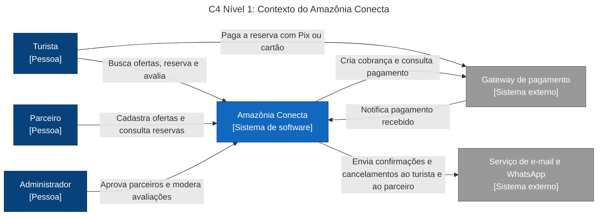
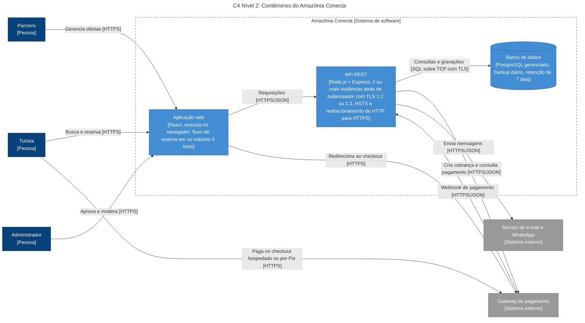
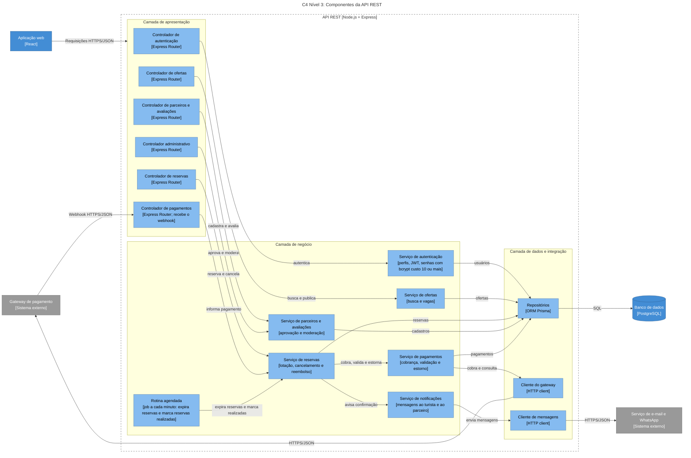
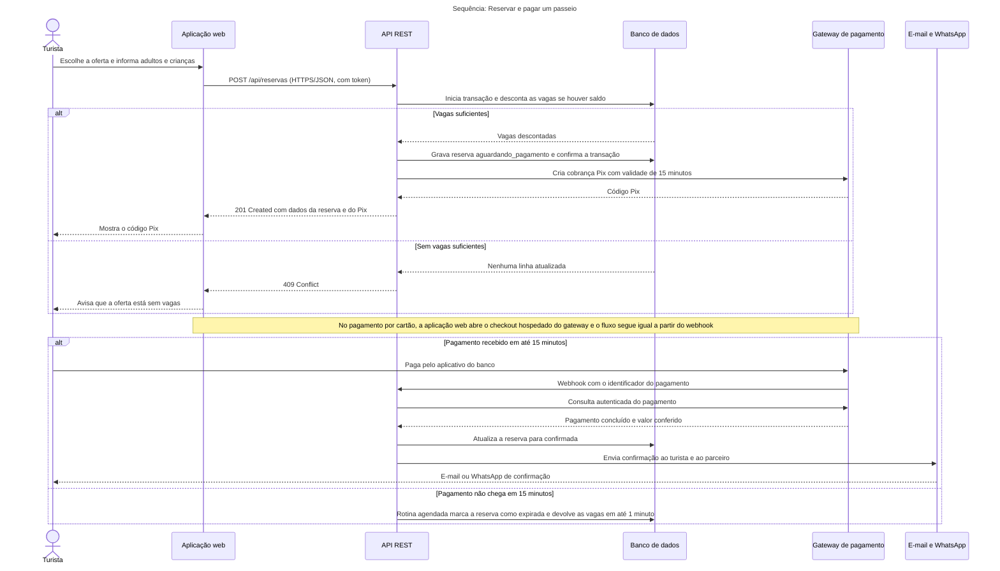

# Amazônia Conecta: Requisitos e Arquitetura

- **Disciplina:** Projetos de Sistemas (CIESA)
- **Trabalho:** Trabalho em Equipe (realizado individualmente)
- **Autor:** Alessandro de Oliveira Ramos
- **Tema:** plataforma de contratação de serviços turísticos em Manaus

---

# Parte 1: Requisitos

## 1.1 Descrição do sistema

O **Amazônia Conecta** é uma plataforma web em que turistas contratam passeios de barco, guias e agências e hospedagens de Manaus. Os parceiros, depois de aprovados pelo administrador, publicam ofertas com período, preço por adulto, preço por criança e número de vagas. O turista busca uma oferta, reserva e paga online, por Pix ou cartão, em um checkout hospedado pelo gateway de pagamento. Com o pagamento confirmado, a plataforma confirma a reserva e avisa turista e parceiro por e-mail ou WhatsApp. Passeios e guias ocorrem em um único dia, e as ofertas de hospedagem são pacotes com data de entrada e de saída. O repasse financeiro ao parceiro está fora do escopo deste trabalho. Há três tipos de usuário: o **turista** busca, reserva, paga, consulta as próprias reservas, cancela e avalia; o **parceiro** se cadastra, publica e gerencia ofertas e acompanha as reservas; o **administrador** aprova parceiros e modera avaliações.

## 1.2 Requisitos funcionais (RF)

| Código | Descrição | Prioridade |
|--------|-----------|------------|
| RF01 | O sistema deve permitir que o parceiro se cadastre informando categoria (passeio de barco, guia/agência ou hospedagem), documento (CPF ou CNPJ) e número do Cadastur. | Alta |
| RF02 | O sistema deve permitir que o administrador aprove ou rejeite o cadastro de parceiros, conferindo a situação regular do Cadastur. | Alta |
| RF03 | O sistema deve permitir que o parceiro aprovado cadastre uma oferta informando título, categoria, descrição, preço por adulto, preço por criança, data de início, data de término e número de vagas (nos passeios de barco, limitado à lotação autorizada da embarcação). | Alta |
| RF04 | O sistema deve permitir que o parceiro edite ou desative uma oferta própria sem reservas confirmadas; havendo reservas, a oferta só pode ser cancelada pelo RF16. | Média |
| RF05 | O sistema deve permitir que o turista busque ofertas por categoria, data e faixa de preço. | Alta |
| RF06 | O sistema deve permitir que o turista visualize os detalhes de uma oferta, o preço total e as vagas disponíveis. | Alta |
| RF07 | O sistema deve permitir que o turista crie uma conta informando nome, e-mail, telefone e senha. | Alta |
| RF08 | O sistema deve permitir que o turista reserve uma oferta informando a quantidade de adultos e de crianças, respeitado o número de vagas disponíveis. | Alta |
| RF09 | O sistema deve permitir que o turista pague a reserva por Pix ou cartão em até 15 minutos após criá-la. | Alta |
| RF10 | O sistema deve permitir que o turista cancele uma reserva, inclusive exercendo o arrependimento em até 7 dias da compra, com o reembolso calculado conforme a RN05. | Média |
| RF11 | O sistema deve permitir que o parceiro visualize as reservas das suas ofertas. | Média |
| RF12 | O sistema deve permitir que o turista e o parceiro recebam, por e-mail ou WhatsApp, a confirmação e o cancelamento de reservas. | Média |
| RF13 | O sistema deve permitir que o turista avalie um passeio ou uma hospedagem depois da data de término da reserva. | Baixa |
| RF14 | O sistema deve permitir que o administrador remova avaliações inadequadas. | Baixa |
| RF15 | O sistema deve permitir que o turista, o parceiro e o administrador acessem o sistema com e-mail e senha. | Alta |
| RF16 | O sistema deve permitir que o parceiro cancele um passeio por motivo de segurança da navegação ou de condição climática, gerando o reembolso das reservas afetadas conforme a RN04. | Alta |
| RF17 | O sistema deve permitir que o turista consulte suas reservas e o estado de cada uma. | Média |

## 1.3 Requisitos não funcionais (RNF)

| Código | Categoria | Descrição | Prioridade |
|--------|-----------|-----------|------------|
| RNF01 | Desempenho | A busca de ofertas deve responder em até 2 segundos em 95% das requisições, com até 200 usuários simultâneos. | Alta |
| RNF02 | Desempenho | A criação de uma reserva deve ser concluída em até 3 segundos em 95% das requisições, sem contar o tempo de resposta do gateway de pagamento. | Alta |
| RNF03 | Segurança | Toda comunicação entre cliente e servidor deve usar HTTPS com TLS 1.2 ou superior (TLS 1.3 preferencial), com 100% das requisições HTTP redirecionadas para HTTPS e cabeçalho HSTS com max-age de pelo menos 31536000 segundos. | Alta |
| RNF04 | Segurança | As senhas devem ser armazenadas somente como hash bcrypt com custo mínimo 10, e senhas com mais de 72 bytes devem ser rejeitadas na validação. | Alta |
| RNF05 | Disponibilidade | O sistema deve ter disponibilidade mínima de 99,5% ao mês, com pelo menos 2 instâncias da API em execução. | Alta |
| RNF06 | Usabilidade | O turista deve concluir uma reserva em no máximo 5 telas a partir da página da oferta. | Média |
| RNF07 | Compatibilidade | O sistema deve funcionar nas duas últimas versões estáveis de Chrome, Firefox, Safari e Edge, em telas a partir de 360 px de largura. | Alta |
| RNF08 | Disponibilidade | O banco de dados deve ter backup diário, retido por 7 dias, de modo que a perda máxima de dados seja de 24 horas. | Média |
| RNF09 | Segurança | 0 (zero) dados de cartão (número, validade ou CVV) devem ser armazenados, processados ou transmitidos pelos sistemas da plataforma; a captura ocorre apenas no checkout hospedado do gateway. | Alta |
| RNF10 | Segurança | 100% das confirmações de pagamento devem ser validadas por consulta autenticada ao gateway antes de a reserva passar para confirmada. | Alta |
| RNF11 | Disponibilidade | A rotina de expiração deve devolver à oferta as vagas de reservas não pagas em até 1 minuto após o vencimento dos 15 minutos de prazo. | Alta |

## 1.4 Regras de negócio (RN)

| Código | Descrição | Base | Prioridade |
|--------|-----------|------|------------|
| RN01 | Só podem prestar serviços de turismo a terceiros, ou intermediá-los, os prestadores de atividade de cadastro obrigatório (meios de hospedagem, agências de turismo, transportadoras turísticas e guias de turismo) que mantenham cadastro regular e dentro da validade no Cadastur. Quem divulga prestadores pela internet ou por plataforma digital só pode divulgar os que estejam cadastrados. | Lei 11.771/2008, arts. 21 e 22 (redação da Lei 14.978/2024); Portaria MTur 38/2021 | Alta |
| RN02 | O número de pessoas a bordo de uma embarcação não pode exceder a lotação máxima autorizada pela Autoridade Marítima, constante da documentação da embarcação. | NORMAM-202/DPC (Marinha do Brasil); Lei 9.537/1997 | Alta |
| RN03 | A embarcação deve portar coletes salva-vidas em bom estado, em número ao menos igual ao de pessoas a bordo, incluindo tamanhos para crianças, em local de fácil acesso. Como política de segurança adotada pelos operadores, todos os passageiros usam o colete durante a navegação. | NORMAM-202/DPC (porte); política de segurança dos operadores (uso) | Alta |
| RN04 | Quando o operador cancela ou interrompe o passeio por segurança da navegação ou condição climática, o turista escolhe entre a devolução integral do valor pago, incluída a taxa de intermediação, e a remarcação sem custo adicional. | CDC, arts. 20 e 35 | Alta |
| RN05 | O consumidor que contrata pela internet pode desistir em até 7 dias corridos da compra e receber de volta, de imediato, tudo o que pagou. Fora desse prazo, o cancelamento pelo turista segue a política do operador, informada antes da compra: reembolso integral com antecedência mínima de 48 horas do início do serviço; com menos de 48 horas, retenção parcial, nunca a perda total do valor. | CDC, art. 49; Decreto 7.962/2013; política do operador | Alta |
| RN06 | O preço de um serviço turístico oferecido ao consumidor é o valor total a pagar, em reais, com tributos, taxas do operador e taxa de intermediação incluídos ou discriminados, informado antes da contratação e mantido até o pagamento. | CDC, arts. 6º, III, e 31; Decreto 5.903/2006 | Média |
| RN07 | A faixa etária de criança e o preço para crianças são definidos por cada operador e informados na oferta antes da compra. | Política do operador; CDC, art. 31 | Média |
| RN08 | Quem intermedeia serviços turísticos de forma remunerada é agência de turismo e precisa do próprio cadastro regular no Cadastur. | Lei 11.771/2008 | Média |

---

# Parte 2: Documento de arquitetura

## 2.1 Diagramas C4 (níveis 1 a 3)

### Nível 1: Contexto

**Diagrama 1: Contexto do Amazônia Conecta (C4 nível 1)**



**Legenda:** azul-escuro = pessoa; azul = sistema em escopo; cinza = sistema externo. O texto entre colchetes indica o tipo do elemento. A seta parte de quem inicia a interação, e o rótulo diz o que trafega.

### Nível 2: Contêineres

**Diagrama 2: Contêineres do Amazônia Conecta (C4 nível 2)**



**Legenda:** azul-escuro = pessoa; azul médio = contêiner do sistema (o texto entre colchetes é a tecnologia e, quando há, a restrição de projeto que o contêiner atende, como o limite de telas da aplicação web e o TLS no balanceador da API); cinza = sistema externo; o cilindro é o banco de dados; a linha tracejada delimita o sistema. Cada seta traz o que trafega e, entre colchetes, o protocolo. A seta do turista ao gateway é o pagamento digitado no checkout hospedado, sem passar pela plataforma, e as relações com os sistemas externos são as mesmas do nível 1. A hospedagem é em nuvem, com a API e o banco em serviços gerenciados.

### Nível 3: Componentes da API REST

**Diagrama 3: Componentes da API REST (C4 nível 3)**



**Legenda:** azul claro = componente interno da API (o texto entre colchetes é a tecnologia ou a responsabilidade); azul médio = outro contêiner; cinza = sistema externo. Os três blocos internos são as camadas de apresentação, negócio e dados e integração. Cada seta mostra a chamada ou o dado que trafega, no sentido de quem inicia.

## 2.2 Registros de decisão (ADRs)

### ADR-001 — Adotar cliente web responsivo em vez de aplicativo nativo

- **Status:** aceita
- **Data:** 2026-11-05

#### Contexto

O turista precisa buscar e reservar sem instalar nada, em qualquer dispositivo (RNF07, Compatibilidade) e concluir a reserva em poucas telas (RNF06, Usabilidade). Os fluxos principais são RF05 a RF09.

#### Alternativas consideradas

**Alternativa A: Aplicação web responsiva (React)**

- A favor: sem instalação; uma única base de código para celular e computador; atualizações imediatas; atende a RNF07 em navegadores e telas a partir de 360 px.
- Contra: sem notificações push nativas; depende de conexão durante o uso.

**Alternativa B: Aplicativo nativo (Android e iOS)**

- A favor: notificações push, melhor integração com o aparelho, algum uso offline.
- Contra: duas bases de código; publicação nas lojas; o turista, que reserva poucas vezes, precisa instalar o app antes de reservar.

#### Decisão

Escolhemos a **Alternativa A**, porque a compatibilidade ampla (RNF07) e a reserva sem a etapa de instalação (RNF06) pesam mais que os recursos nativos para este público.

#### Consequências

- Positivas: menor custo de desenvolvimento e manutenção; o turista reserva sem a etapa de instalação; uma única versão em produção.
- Negativas: sem push, por isso as confirmações usam e-mail e WhatsApp (RF12); em áreas com internet instável, como trechos ribeirinhos, o uso durante o passeio fica limitado. Se a plataforma crescer, uma versão instalável (PWA) pode ser avaliada em novo ADR.

### ADR-002 — Usar banco relacional (PostgreSQL) para ofertas e reservas

- **Status:** aceita
- **Data:** 2026-11-05

#### Contexto

Uma reserva não pode ultrapassar as vagas da oferta (RF08), e a oferta de passeio de barco não pode ter mais vagas que a lotação da embarcação (RN02, aplicada no RF03). A busca deve responder em até 2 s (RNF01) e a criação da reserva em até 3 s (RNF02). Pagamentos e reembolsos exigem registros consistentes (RF09, RF10).

#### Alternativas consideradas

**Alternativa A: PostgreSQL (relacional)**

- A favor: transações ACID; a vaga é descontada em uma única instrução condicional (`UPDATE ofertas SET vagas_disponiveis = vagas_disponiveis - :n WHERE id = :id AND vagas_disponiveis >= :n`), com `CHECK (vagas_disponiveis >= 0)` como segunda barreira; índices por categoria, período e preço atendem a RNF01; o domínio (parceiro, oferta, reserva, pagamento, avaliação) é relacional.
- Contra: atributos específicos de cada categoria exigem colunas opcionais ou um campo JSONB; escalar escrita horizontalmente é mais trabalhoso.

**Alternativa B: MongoDB (não relacional)**

- A favor: esquema flexível para ofertas de categorias diferentes; escala horizontal mais simples; suporta transações com vários documentos em conjuntos de réplicas.
- Contra: transações com vários documentos têm custo de desempenho maior que a escrita em um único documento, e o modelo documental não oferece chaves estrangeiras nem restrições declarativas de capacidade, o que desloca a integridade para o código da aplicação.

#### Decisão

Escolhemos a **Alternativa A**, porque a regra de capacidade (RF08 e RN02) é uma restrição transacional sobre linhas e o domínio é naturalmente relacional.

#### Consequências

- Positivas: sem reservas acima das vagas mesmo com pedidos simultâneos; integridade referencial entre parceiro, oferta, reserva e avaliação; consultas rápidas com índices.
- Negativas: campos específicos por categoria ficam em colunas opcionais ou JSONB; volumes muito altos pedirão réplicas de leitura e particionamento; mudanças de esquema exigem migrações.

### ADR-003 — Autenticar com token JWT de acesso curto em vez de sessão no servidor

- **Status:** aceita
- **Data:** 2026-11-05

#### Contexto

Os três perfis (turista, parceiro e administrador) acessam com e-mail e senha (RF15) e têm permissões diferentes (por exemplo, RF04, RF14 e RF16). A API deve rodar em 2 ou mais instâncias para sustentar a disponibilidade de 99,5% (RNF05) e as senhas devem ser protegidas (RNF04).

#### Alternativas consideradas

**Alternativa A: Token JWT de acesso (15 minutos) mais refresh token em cookie HttpOnly**

- A favor: qualquer instância valida o token de acesso sem consultar o banco e sem afinidade de sessão, então reinícios e implantações não derrubam logins (RNF05); o perfil vai dentro do token, o que simplifica a autorização por perfil.
- Contra: o token de acesso não pode ser revogado antes de expirar; o refresh token precisa ser guardado (como hash) e rotacionado, o que reintroduz um estado mínimo no banco; um token mal guardado no navegador fica exposto a XSS.

**Alternativa B: Sessão no servidor com cookie HttpOnly e armazenamento compartilhado (Redis)**

- A favor: revogação imediata da sessão; nenhum token fica acessível a scripts.
- Contra: exige um armazenamento de sessões compartilhado entre as instâncias, mais um componente para operar que, se falhar, derruba todos os logins; consulta o armazenamento a cada requisição.

#### Decisão

Escolhemos a **Alternativa A**, porque várias instâncias da API sem afinidade de sessão e sem um componente extra no caminho de cada requisição reduzem as janelas de indisponibilidade (RNF05). A redundância do banco fica a cargo do serviço gerenciado.

#### Consequências

- Positivas: escala e recuperação mais simples; autorização por perfil direto no token; o token de acesso fica apenas em memória no navegador.
- Negativas: revogação imediata do token de acesso é impossível (a exposição dura até 15 minutos); é preciso implementar renovação com rotação do refresh token e guardar o hash dele no banco; as senhas seguem com hash bcrypt (RNF04) em qualquer das opções.

## 2.3 Comunicação cliente-servidor

### Fluxo de requisição e resposta

Caso de uso completo: **o turista reserva e paga um passeio** (RF08, RF09 e RF12). A reserva fica `aguardando_pagamento` por até 15 minutos; se o pagamento não chega, a rotina agendada de expiração libera as vagas em até 1 minuto após o vencimento (RNF11).

**Diagrama 4: Sequência de reservar e pagar um passeio**



**Legenda:** setas cheias são chamadas, setas tracejadas são respostas; cada bloco `alt` mostra dois caminhos possíveis do mesmo caso de uso; a nota explica o pagamento por cartão. O webhook sozinho não confirma a reserva: a API só confirma depois de consultar o gateway (RNF10). A devolução das vagas no ramo sem pagamento atende a RNF11.

### Estados da reserva

| Estado | Quando ocorre | O que muda no sistema |
|--------|---------------|-----------------------|
| `aguardando_pagamento` | A reserva é criada | As vagas são descontadas da oferta |
| `confirmada` | O gateway confirma o pagamento | Turista e parceiro recebem a confirmação |
| `expirada` | Passam 15 minutos sem pagamento | As vagas voltam para a oferta em até 1 minuto (RNF11) |
| `cancelada` | O turista cancela ou o parceiro cancela o passeio | Reembolso conforme RN04 e RN05; as vagas voltam para a oferta |
| `realizada` | A data de término passa (a rotina agendada marca a reserva) | O turista pode avaliar (RF13) |

### Requisições HTTP

Todas usam HTTPS. As rotas protegidas enviam o cabeçalho `Authorization: Bearer <token>`.

**1. Buscar ofertas**: RF05 (rota pública, sem token)

```http
GET /api/ofertas?categoria=passeio_barco&data=2026-12-10
```

Resposta `200 OK`:

```json
{
  "total": 2,
  "ofertas": [
    {
      "id": 42,
      "titulo": "Encontro das Águas de lancha",
      "categoria": "passeio_barco",
      "dataInicio": "2026-12-10",
      "dataFim": "2026-12-10",
      "precoAdulto": 180.00,
      "precoCrianca": 90.00,
      "vagasDisponiveis": 14
    },
    {
      "id": 57,
      "titulo": "Igarapé do Tarumã com almoço regional",
      "categoria": "passeio_barco",
      "dataInicio": "2026-12-10",
      "dataFim": "2026-12-10",
      "precoAdulto": 220.00,
      "precoCrianca": 110.00,
      "vagasDisponiveis": 6
    }
  ]
}
```

**2. Criar uma reserva**: RF08

```http
POST /api/reservas
Authorization: Bearer <token-do-turista>
Content-Type: application/json
```

Corpo da requisição:

```json
{
  "ofertaId": 42,
  "adultos": 2,
  "criancas": 1
}
```

Resposta `201 Created`, com o cabeçalho `Location: /api/reservas/1031`:

```json
{
  "id": 1031,
  "ofertaId": 42,
  "status": "aguardando_pagamento",
  "adultos": 2,
  "criancas": 1,
  "valorTotal": 450.00,
  "pagamento": {
    "metodo": "pix",
    "codigoPix": "COPIA-E-COLA-EXEMPLO",
    "expiraEm": "2026-12-01T15:30:00-04:00"
  }
}
```

O `valorTotal` já inclui tributos e a taxa de intermediação (RN06): os preços por adulto e por criança da oferta já são valores finais. O valor total é 2 × 180,00 + 1 × 90,00 = 450,00. Se a oferta não tiver vagas suficientes, a resposta é `409 Conflict`:

```json
{
  "erro": "vagas_insuficientes",
  "mensagem": "A oferta 42 tem apenas 2 vagas disponíveis.",
  "vagasDisponiveis": 2
}
```

**3. Editar uma oferta de outro parceiro (caso de erro 4xx)**: RF04

```http
PUT /api/ofertas/42
Authorization: Bearer <token-do-parceiro-B>
Content-Type: application/json
```

Corpo da requisição (o `PUT` substitui a oferta inteira, por isso leva todos os campos; `vagas` é a capacidade total, e `vagasDisponiveis` é `vagas` menos as reservas):

```json
{
  "titulo": "Encontro das Águas de lancha",
  "categoria": "passeio_barco",
  "descricao": "Passeio de 3 horas com saída do porto de Manaus.",
  "dataInicio": "2026-12-10",
  "dataFim": "2026-12-10",
  "precoAdulto": 150.00,
  "precoCrianca": 75.00,
  "vagas": 20,
  "ativa": true
}
```

Resposta `403 Forbidden` (a oferta 42 pertence a outro parceiro):

```json
{
  "erro": "acesso_negado",
  "mensagem": "Esta oferta pertence a outro parceiro."
}
```

**4. Cancelar uma reserva**: RF10

```http
DELETE /api/reservas/1031
Authorization: Bearer <token-do-turista>
```

O registro não é apagado: a reserva passa para `cancelada`. Resposta `200 OK` para uma reserva `confirmada` cancelada com 48 horas ou mais de antecedência (RN05):

```json
{
  "id": 1031,
  "status": "cancelada",
  "motivo": "cancelamento_turista",
  "reembolso": {
    "tipo": "integral",
    "valor": 450.00,
    "destino": "Pix de origem"
  }
}
```

### HTTPS

**Dados que precisam de proteção:**

- credenciais de acesso (e-mail, senha e os tokens);
- dados pessoais do turista e do parceiro (nome, e-mail, telefone, documento);
- dados de reserva e de pagamento (valores e código Pix); os dados do cartão são digitados no checkout hospedado do gateway e não passam pela plataforma (RNF09).

**O que o TLS oferece:** o conteúdo trafega criptografado e não pode ser lido por quem intercepta a rede (confidencialidade); qualquer alteração no meio do caminho é detectada (integridade); e o certificado confirma que o turista está falando com o Amazônia Conecta e não com um site falso (autenticidade do servidor).

O TLS não protege os dados guardados no banco nem um aparelho já comprometido; para isso existem o hash das senhas, o controle de acesso por perfil e o backup. Atende a RNF03: TLS 1.2 ou superior (1.3 preferencial), redirecionamento de HTTP para HTTPS e cabeçalho HSTS.

**Dados pessoais e LGPD:** a plataforma é controladora dos dados de turistas e de parceiros pessoas naturais. Cadastro, reserva, pagamento e confirmação usam a execução de contrato como base legal; a guarda de registros fiscais usa obrigação legal; mensagens de marketing exigem consentimento separado. A reserva guarda apenas a quantidade de crianças, e não o nome ou a idade delas. O aviso de privacidade informa as finalidades, o prazo de guarda e o canal para o titular exercer seus direitos, e lista os operadores (gateway, serviço de mensagens e hospedagem).

## 2.4 Rastreabilidade

### RNF → decisão

| RNF | Decisão que atende |
|-----|--------------------|
| RNF01: Busca em até 2 s | ADR-002 (índices no PostgreSQL); C4 nível 3 (Serviço de ofertas e Repositórios) |
| RNF02: Reserva em até 3 s | ADR-002 (desconto de vagas em uma instrução condicional); C4 nível 3 (Serviço de reservas) |
| RNF03: HTTPS com TLS 1.2+ e HSTS | C4 nível 2 (API e balanceador, rotulados com TLS 1.2 ou 1.3, HSTS e redirecionamento de HTTP para HTTPS; setas HTTPS e HTTPS/JSON); seção 2.3 (HTTPS) |
| RNF04: Hash bcrypt de senha | C4 nível 3 (Serviço de autenticação, rotulado com bcrypt custo 10 ou mais); ADR-003 (consequências) |
| RNF05: Disponibilidade de 99,5% e 2+ instâncias | ADR-003 (API sem afinidade de sessão); C4 nível 2 (API com 2 ou mais instâncias atrás de balanceador) |
| RNF06: Reserva em até 5 telas | C4 nível 2 (aplicação web, rotulada com fluxo de reserva em no máximo 5 telas); ADR-001 (aplicação web, sem etapa de instalação) |
| RNF07: Navegadores e telas a partir de 360 px | ADR-001 |
| RNF08: Backup diário com retenção de 7 dias | C4 nível 2 (contêiner Banco de dados, rotulado com backup diário e retenção de 7 dias) |
| RNF09: Nenhum dado de cartão na plataforma | C4 nível 2 (seta do Turista ao gateway, pagamento no checkout hospedado, e seta de redirecionamento da aplicação web); seção 2.3 (HTTPS) |
| RNF10: Pagamento validado por consulta ao gateway | C4 nível 3 (Serviço de reservas, Serviço de pagamentos e Cliente do gateway); diagrama de sequência (consulta autenticada antes de confirmar) |
| RNF11: Vagas devolvidas em até 1 min após os 15 min de prazo | C4 nível 3 (Rotina agendada, job a cada minuto); diagrama de sequência (ramo em que o pagamento não chega em 15 minutos) |

### Requisição HTTP → RF

| Requisição | RF correspondente |
|------------|-------------------|
| `GET /api/ofertas` | RF05: Buscar ofertas |
| `POST /api/reservas` | RF08: Reservar uma oferta |
| `PUT /api/ofertas/{id}` | RF04: Editar ou desativar uma oferta |
| `DELETE /api/reservas/{id}` | RF10: Cancelar uma reserva |

### Componente do nível 3 → requisitos

| Componente | Requisitos |
|------------|------------|
| Controlador e Serviço de autenticação | RF07, RF15, RNF04 |
| Controlador e Serviço de ofertas | RF03, RF04, RF05, RF06, RN02, RN06, RN07 |
| Controlador e Serviço de reservas | RF08, RF10, RF11, RF16, RF17, RN02, RN04, RN05, RNF02 |
| Controlador de pagamentos, Serviço de pagamentos e Cliente do gateway | RF09, RNF09, RNF10 |
| Controlador e Serviço de parceiros e avaliações; Controlador administrativo | RF01, RF02, RF13, RF14, RN01, RN08 |
| Serviço de notificações e Cliente de mensagens | RF12 |
| Rotina agendada | RF09, RF13, RNF11 |
| Repositórios | RNF01, RNF02 |

### ADR → requisitos

| ADR | Requisitos que motivam a decisão |
|-----|----------------------------------|
| ADR-001: Cliente web responsivo | RNF06, RNF07, RF05 a RF09 |
| ADR-002: PostgreSQL | RNF01, RNF02, RF08, RF03, RN02 |
| ADR-003: JWT de acesso curto | RNF05, RNF04, RF15 |
